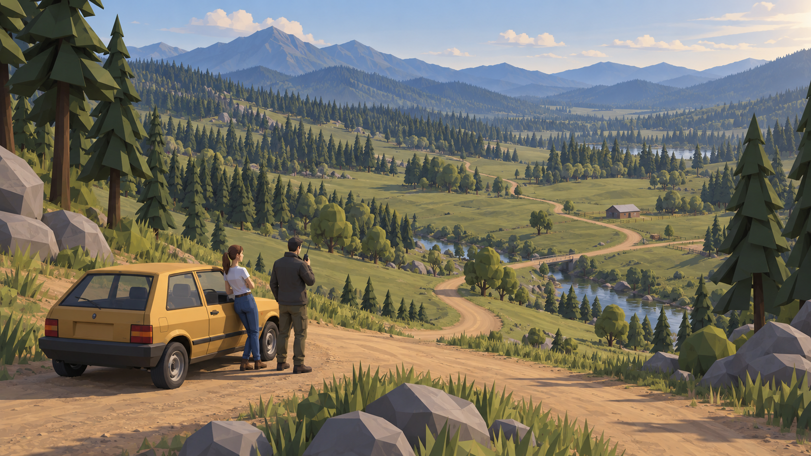
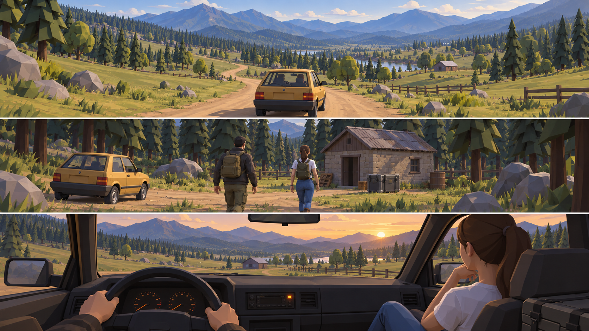

# Manyworld 자연 월드 아트 방향

이어받기: [2026-10-12 아트 방향 핸드오프](HANDOFF-2026-10-12-art-direction.md).

2026-10-12. 사용자 요청에 따라 한국 동네 배경을 버리고, 신티 자산을 중심으로 자연 속 운전과 현장 미션을 연결한다. 아래 이미지는 built-in ImageGen으로 만든 목표 콘셉트이며 Unity 적용 화면이 아니다.

## 목표 이미지

현재 선택안: [위성을 뺀 다섯 장면과 여덟 이상현상](art/2026-10-12/selected-scenes-v3/README.md). 2026-10-12 사용자 선택을 반영한 가장 최근 이미지 세트다.

2026-10-12 추가 탐색: [하늘·숲·수면에 기이한 신티 물체가 있는 목표 샷과 실제 자산 후보](art/2026-10-12/anomaly-asset-selection.md). 아래 이미지는 기이한 물체를 넣기 전의 자연 배경 기준이다.

첫 이미지는 차와 동료가 있는 길가 공터에서 넓은 분지를 내려다보는 대표 구도다. 두 번째는 위부터 주행, 하차 후 현장 접근, 차로 돌아온 뒤 콜 대기의 흐름이다. 같은 노란 소형차와 동료를 유지했다. 차량 색과 구체적인 모델은 제안이며 최종 확정 사항이 아니다.

## 현재 프로젝트

- 경로: `C:\VC3\manyworld`. Unity 6000.3.22f1, URP. 시작 시 Git 변경 없음.
- `Assets/_Project/Scenes/Main.unity`에서 GameManager가 월드와 UI를 코드로 생성한다.
- `WorldTerrainBuilder`: 1024m × 1024m 분지, 산·강·흙길 5개 노선·거점 5곳, 번호에 따른 숲·침수·폐허 변화. 큰 월드의 기반이 이미 있다.
- `TownBuilder`, `KoreanBuildings`: 한국식 단층집·상가·골목과 마을 시설이 현재 시각 방향에 묶여 있다.
- `TicoCar`, `MissionController`: 월드 운전, 승하차, 차량 피해, 동료 동승·현장 행동, 계약 정산.
- `DriveSession`: 동네 배달 중 무전 콜을 받는 흐름. 미션 종료 후 기본 전환은 Hub/Settlement이므로, **자연 월드 안에서 미션 후 다시 차에 타 콜을 기다리는 연속 흐름은 별도 구현 대상**이다.
- ArtCatalog의 GUID를 로컬 meta에 대조했다. 나무 15, 죽은 나무 4, 덤불 3, 바위 9, 풀 4, 농장 건물 9, 울타리 3. 조사한 항목에 미해결 참조 없음. 상세 경로는 `art/2026-10-12/installed-art-evidence.json`.
- 현재 인물은 Synty가 아닌 Tripo FBX이고 주행 차량 차체는 ithappy Car_06이다. Synty 소형차도 카탈로그에 별도로 연결돼 있다.

## 아트 기준

넓은 초원과 숲 사이로 이어지는 흙길을 화면의 중심으로 삼는다. 숲은 균일한 무작위 나무 분포 대신 덩어리와 빈 공간을 만든다. 길은 전방으로 이어져야 하며, 나무와 바위가 달릴 폭이나 현장 진입로를 가리지 않아야 한다.

색은 바랜 세이지·올리브 초원, 짙은 침엽수, 회색 바위, 황토색 길, 푸른 먼 능선으로 구성한다. 따뜻한 오후와 차가운 숲 그늘을 대비시켜 조용하지만 약간 불길한 분위기를 만든다. 필름 그레인과 바닥 입자를 늘려 분위기를 만드는 방식은 피한다.

건물은 넓은 풍경 속의 작은 목적지다. 오두막·헛간·급수 시설·장비 상자 정도로 구성하며 도시 스카이라인과 한국식 간판·장승·기와·아파트를 새 방향에서 사용하지 않는다. 한국어 UI와 인물 이름을 지우는 결정은 포함하지 않는다.

차는 이동 수단이면서 현장에 남겨 두는 귀환 지점, 다음 콜을 기다리는 작은 쉼터다. 소형차 실루엣을 유지하고 대형 오프로드 차량을 전제로 월드를 설계하지 않는다. 실내 샷은 이 역할을 보여 주는 제안이다. 현재 PlayerCamera는 외부 차량 카메라를 사용한다.

## 보유 자산과 구현 대응

아래 항목은 라이브러리의 패키지 이름만 확인한 것이 아니라 이 프로젝트 내 파일 존재와 관련 카탈로그 연결을 확인했다. 로컬 자산은 공개 저장소에 복사하지 않는다.

| 용도 | 로컬 팩과 확인 모델 | 사용 방식 |
|---|---|---|
| 숲 경계와 능선 | PolygonNature: SM_Tree_Pine_01/02, SM_Tree_Pine_Large_01, 둥근 나무·자작나무 | 침엽수 중심으로 큰 덩어리 구성, 활엽수는 물가와 공터 가장자리 |
| 초원과 가까운 풀 | PolygonNatureBiomes/PNB_Meadow_Forest: SM_Env_Tree_Meadow_01/02, SM_Env_Grass_Tall_Clump_01/02 | 넓은 잔디 면 위에 가까운 풀만 집중 |
| 바위 | PolygonNature: SM_Rock_Boulder_01, SM_Rock_Cluster_Large_01/02; Meadow Forest: SM_Env_Rock_Pile_01/02 | 경사와 숲 경계, 도로 바깥에 배치 |
| 현장 건물 | Meadow Forest: SM_Bld_Stone_Cabin_01; PolygonFarm: SM_Bld_Barn_01/02, SM_Bld_Shelter_01 | 거점마다 1~3개, 기존 목표와 상호작용 앵커 보존 |
| 먼 시설과 울타리 | PolygonFarm: SM_Bld_WaterTower_01, 목재·철망 울타리 | 시설 식별용 랜드마크와 드문 경계선 |
| 소형차 | PolygonCity: SM_Veh_Car_Small_01 | 아트 후보. ithappy 차체에서 바꾸려면 바퀴·좌석·승하차·차량 판정은 기존 계약 유지 |
| 배경 차량 | PolygonTown: SM_Veh_Pickup_01 | 드문 현장 소품. 주인공 차량 교체를 전제하지 않음 |

## 적용 순서 제안

1. **도로 구간 하나의 기준 화면**: 150~250m 정도의 곡선 도로, 숲 경계, 작은 공터, 오두막 한 곳을 기존 지형 위에 구성한다. 주행 카메라에서 전방 길, 걸어가는 카메라에서 목적지와 차가 잘 보이는지 확인한다. 이 단계에서 광원·그림자·지형 색·원경을 맞춘다.
2. **기존 거점의 외형 전환**: 기존 목표·게이트·중도금 위치와 판정은 유지하면서 한국식 마을 외형을 신티 농장·현장 시설로 전환한다. 처음부터 전체 지형이나 임무 규칙을 다시 만들지 않는다.
3. **분지 전체의 밀도 조절**: 초원/숲/하천의 큰 면을 나누고 길과 중요한 시야를 비운다. LOD, 나무 빌보드, 지형 재질, 풀 거리와 프레임 시간을 실제 플레이어에서 확인한다.
4. **차량 콜 대기 흐름**: 현장 완료 후 차에 돌아가서 대기하거나 이동 중 콜을 받을 수 있도록 GameManager/DriveSession 전환을 설계한다. 정산·세이브·동료·콜 경쟁은 보존한다. 차 내부 카메라는 별도 후속 범위다.
5. **세계 변형**: 같은 지리 위에 안개·고사목·침수·빛을 바꾼다. 밤/독가스/소리 반응 규칙의 정보 전달과 시인성을 우선한다.

## 확인 결과와 남은 차이

- 두 최종 PNG 모두 프로젝트에 복사했고, 각 1672 × 941 픽셀, 파일 존재·크기·SHA-256을 확인했다. 원본/표시 크기에서 구도, 차·동료의 연속성, 길의 연결, 한국 동네 요소 배제, 저노이즈 면 처리를 시각 확인했다.
- 생성된 나무·차·사람·오두막은 보유 프리팹의 정확한 렌더가 아니다. 인물과 오두막은 일부 보유 신티 자산보다 세밀하다. 실제 설치 때 실루엣·스케일·원본 재질에 맞춰야 한다.
- 콘셉트의 먼 능선과 넓은 원경은 풍경의 목표다. 현재 플레이 가능한 영역은 1024m 분지이며 이미지 전체 거리까지 플레이 가능하다는 뜻이 아니다.
- 세 장면 시트는 한 장의 가로 이미지 안에 세 개의 넓은 스트립으로 생성됐다. 개별 게임 화면의 정확한 16:9 카메라 테스트 자료는 아니다.
- 기존 `Builds/Windows/Manyworld.exe`는 2026-10-08 빌드다. 숨김 실행과 `-mwshots`로 얻은 캡처 14개는 모두 검은 화면이었다. 현재 소스의 화면 일치나 아트 품질 증거로 사용하지 않는다. 로그에는 제47/200번 월드 생성과 나무 Soft Occlusion 경고가 있다. 실행이 끝났으며 재빌드나 렌더링 코드 수정은 하지 않았다.
- 이번 변경은 이미지와 방향 기록뿐이다. 런타임, 물리, 충돌, 입력, 세이브, 오디오, 기존 자산은 수정하지 않았다. 최신 소스의 네이티브 화면, 실제 플레이, 성능, 밤/독가스 세계의 시각 검증은 남아 있다.

## 이어서 작업할 때

이 문서와 두 이미지, `installed-art-evidence.json`을 먼저 확인한다. 다음 구현의 최소 단위는 위 1번 도로 구간 하나다. 에디터가 열려 있으므로 사용자 작업 상태를 보존한다. 자동 캡처의 검은 화면부터 원인을 확인하고 실제 렌더가 나오는 경로를 확보한 뒤 전후 화면을 비교한다.

프롬프트 전문: `art/2026-10-12/imagegen-prompts.txt`.

