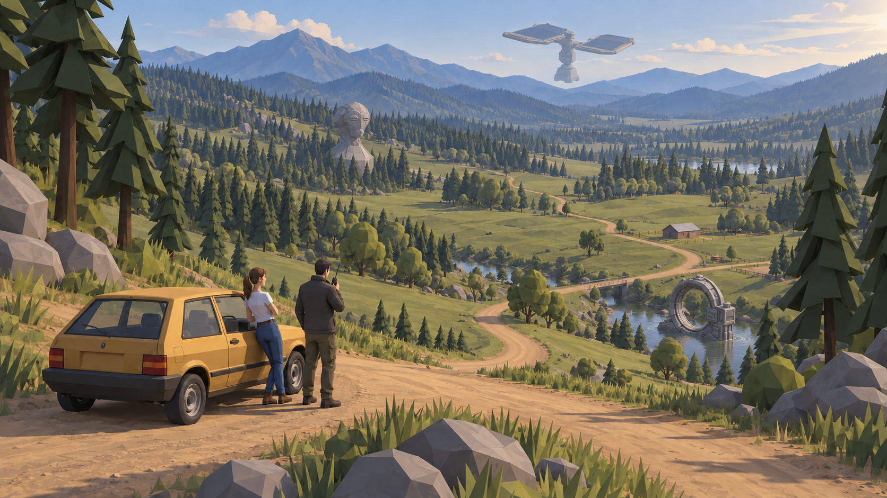
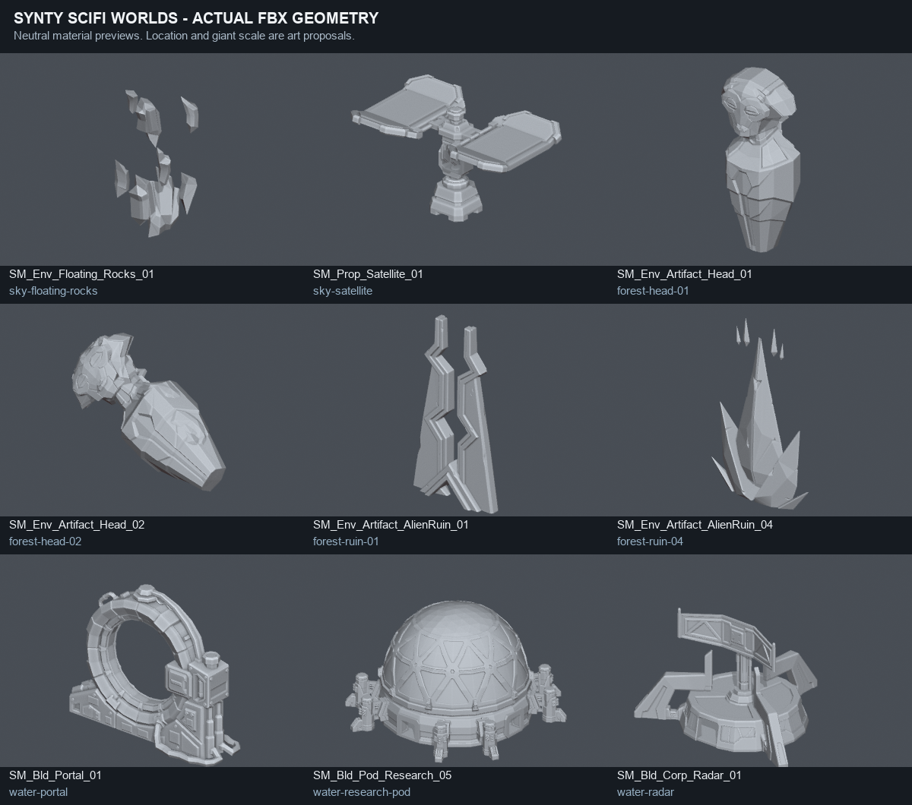

# Manyworld 자연 월드의 기이한 물체 후보

이 문서는 초기 후보 탐색 기록이다. 현재 선택안은 [위성을 제거한 다섯 장면](selected-scenes-v3/README.md)이다. 아래 위성은 현재 선택안에서 제외됐다.

2026-10-12. 넓은 자연 월드 속 하늘·숲·물에 기이한 물체를 드물게 배치한다. 자연의 형태와 운전 경로는 유지하고, 물체의 위치·크기·정지 상태로 이상함을 만든다.

위 이미지는 기존 대표 샷을 built-in ImageGen으로 편집한 목표 콘셉트다. 실제 신티 FBX 렌더를 형태 레퍼런스로 사용했다. Unity에 적용하거나 프리팹을 그대로 렌더한 결과는 아니다.

## 우선 후보

세 후보를 같은 팩에서 확보할 수 있다. 기이한 물체마다 새 디자인을 만들기보다 원래 신티 모델을 배치·확대해 사용한다. 아래 크기와 배치는 제안이며 최종 월드 설계나 설치 상태가 아니다.

| 장소 | 실제 자산 | 목표 배치 | 보유 및 설치 상태 |
|---|---|---|---|
| 하늘 | POLYGON SciFi Worlds / SM_Prop_Satellite_01 | 날개 두 장과 중앙 기계 기둥을 가진 위성 전체가 지지대 없이 공중에 정지. 화면 폭 약 15%, 가까운 지형에서 멀리 떨어진 원경 | 라이브러리 보유, 다른 로컬 프로젝트의 FBX·프리팹 확인. Manyworld 미설치 |
| 숲 | POLYGON SciFi Worlds / SM_Env_Artifact_Head_01 | 각진 머리 유물의 하단을 숲이 가리고 얼굴과 목만 나무 위로 드러남. 빛나는 눈이나 생물 움직임 없이 방향만 계곡을 향함 | 같은 상태 |
| 물 | POLYGON SciFi Worlds / SM_Bld_Portal_01 | 물에 잠긴 낮은 기반과 오른쪽 기계함을 가진 둥근 링. 가운데는 비어 있고 수면 반사로 위치를 읽음. 육지와 잇는 다리 없음 | 같은 상태 |

위성은 비행기·UFO로 바꾸지 않고 두 패널과 중앙 기둥의 실제 실루엣을 유지한다. 머리는 살아 있는 몬스터 대신 조각 같은 유물이다. 링은 포털 기능이나 발광 막을 전제하지 않는다. 미션 목표와 무관한 풍경이라도 '저곳에 무엇이 있나'라는 호기심을 만들 수 있다.

**한 샷에 세 종류를 함께 넣은 것은 비교용이다.** 실제 구역에서는 큰 기이한 물체 하나를 중심으로 두고, 다른 물체는 원경이나 숲의 가림 뒤에 둔다. 도로·승하차 공터·목표 접근로를 가리지 않는다. 위성은 운전 중에도 발견하는 원경, 유물은 숲 가까이에서 드러나는 중경, 링은 물가 접근 때 관찰하는 대상으로 역할을 나눈다.

## 추가로 확인한 모델

이 비교판의 9개 모델은 **실제 FBX를 Blender에서 직접 렌더**했다. 단색 회색은 구조를 비교하기 위한 임시 재질이다. 원본 텍스처·Unity URP 재질·애니메이션·효과가 정상이라는 증거는 아니다.

| 모델 | 활용 가능성 |
|---|---|
| SM_Env_Floating_Rocks_01 | 수직으로 흩어진 암석. 밤이나 중력 이상 세계의 제한된 구역에 적합 |
| SM_Prop_Satellite_01 | 두 패널의 위성. 공중 정지 물체의 우선 후보 |
| SM_Env_Artifact_Head_01 | 세로로 긴 머리 유물. 숲의 우선 후보 |
| SM_Env_Artifact_Head_02 | 기울어진 머리/몸통 유물. 쓰러진 거대 조각으로 숲 가장자리나 물가에 활용 |
| SM_Env_Artifact_AlienRuin_01 | 갈라진 두 기둥 형태. 숲속에서 조금씩 드러나는 현장 랜드마크 |
| SM_Env_Artifact_AlienRuin_04 | 뾰족한 유물과 위쪽 조각들. 날카로운 분위기의 다른 세계에 활용 |
| SM_Bld_Portal_01 | 원형 링과 옆 기계함. 수면의 우선 후보 |
| SM_Bld_Pod_Research_05 | 기하학 패널로 된 둥근 연구 돔. 물 위에 정지하거나 반쯤 잠긴 돔의 후보 |
| SM_Bld_Corp_Radar_01 | 넓은 기반과 레이더 상판. 외딴 공터의 버려진 시설 후보 |

SciFi Space의 Station 01/02와 EscapePod도 패키지 manifest에는 있지만 조사한 원본 프로젝트에 FBX가 없어 이번 형태 비교와 이미지에 사용하지 않았다. 'monolith'라는 이름의 모델은 현재 카탈로그 검색에서 찾지 못했다. 이를 새 커스텀 모놀리스가 있는 것처럼 취급하지 않는다.

## 정확한 원본 위치

라이브러리:
`F:\synty&happy\SyntySpacePacks\POLYGON_SciFi_Worlds_Unity_2022_3_v1_12_2.unitypackage`

manifest:
`F:\synty&happy\SyntySpacePacks\catalog\manifests\POLYGON_SciFi_Worlds_Unity_2022_3_v1_12_2.txt`

형태 확인에 사용한 실제 모델:
`D:\Codex\cube125-unity\Assets\Synty\PolygonSciFiWorlds\Models\<위 모델명>.fbx`

우선 후보 프리팹:
- `Assets/Synty/PolygonSciFiWorlds/Prefabs/Props/SM_Prop_Satellite_01.prefab`
- `Assets/Synty/PolygonSciFiWorlds/Prefabs/Environments/SM_Env_Artifact_Head_01.prefab`
- `Assets/Synty/PolygonSciFiWorlds/Prefabs/Buildings/SM_Bld_Portal_01.prefab`

모델별 존재 확인, Blender mesh 수·원본 bounds, 렌더 위치는 `anomalies/native-model-previews.json`에 있다. bounds는 Blender의 직접 FBX import 관측치다. Unity에 설치할 때 importer scale과 원본 prefab transform을 별도로 확인한다.

## 검증과 적용 범위

- 목표 샷 1672 × 941 PNG를 프로젝트에 복사했고 파일 크기와 SHA-256을 `anomalies/verification.json`에 기록했다.
- 원본 크기와 표시 크기에서 세 물체가 구분되고, 위성의 두 패널/중앙 기둥·머리 유물·링의 옆 기계함이 레퍼런스 형태를 반영하는지 확인했다.
- 차와 두 인물, 앞쪽 길과 자연물의 구도는 유지된다. ImageGen 편집이므로 변경 밖 영역의 픽셀 동일성을 보증하지 않는다.
- 수면 링을 보여 주기 위해 해당 하천의 한 구간이 작은 웅덩이처럼 넓어졌다. 실제 적용 때는 현재 물 메시·충돌·주행 경로와 비교해야 한다.
- 새로운 프리팹 설치, 재질 변경, 월드 코드, 충돌, 게임 규칙, 입력, 저장, 오디오 변경은 하지 않았다. 원본 프로젝트와 라이브러리는 읽기만 했다.
- 다음 단계는 같은 세 후보를 Unity의 검증용 도로 구간에 실제 배치해 원본 프리팹의 형태·색·스케일·원경 가시성을 비교하는 것이다. 기능·미션·콜 대기와의 연결은 별도 구현이다.

생성 프롬프트 전문: `anomalies/imagegen-prompt-v2.txt`.

