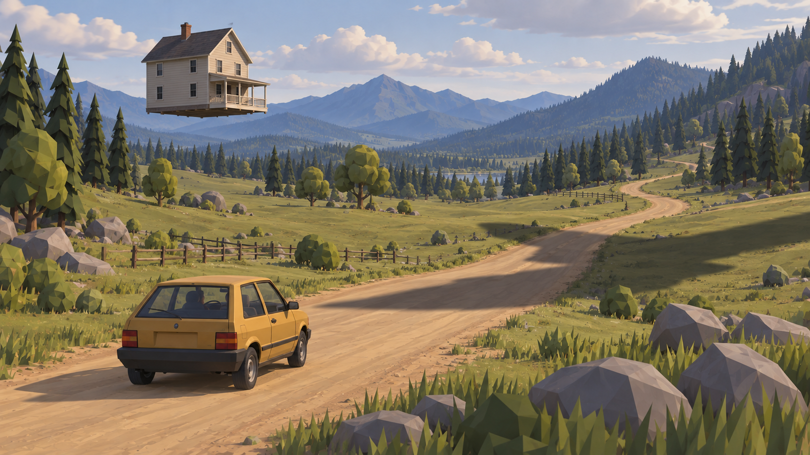
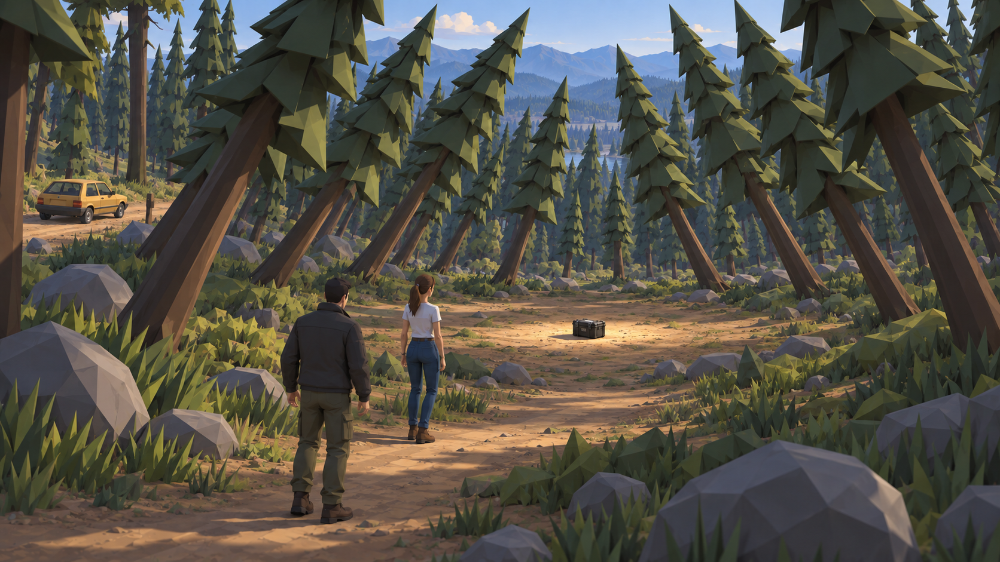
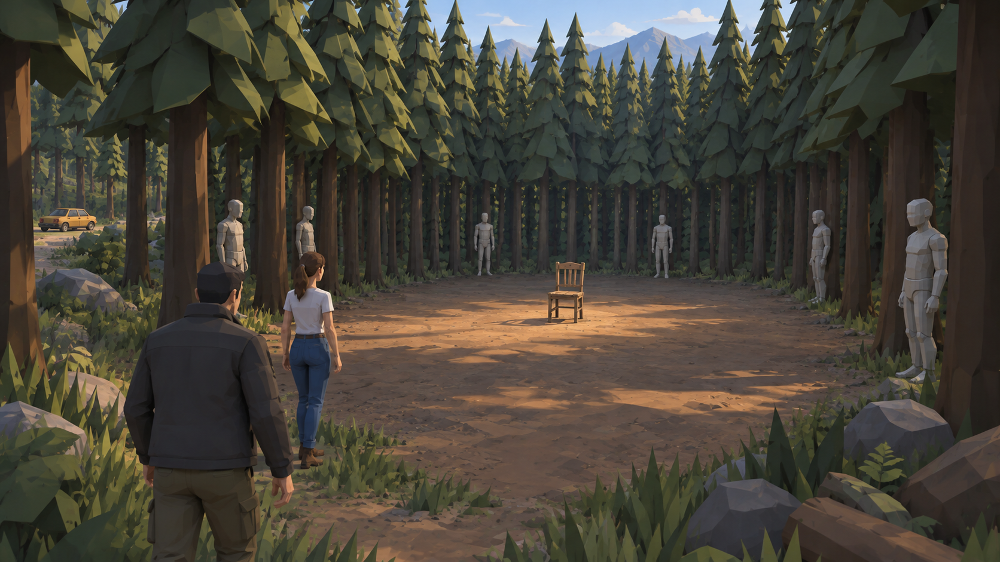
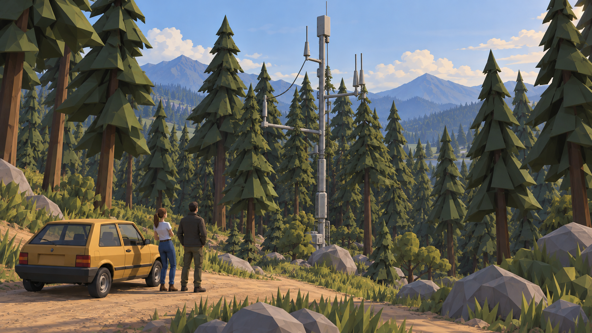
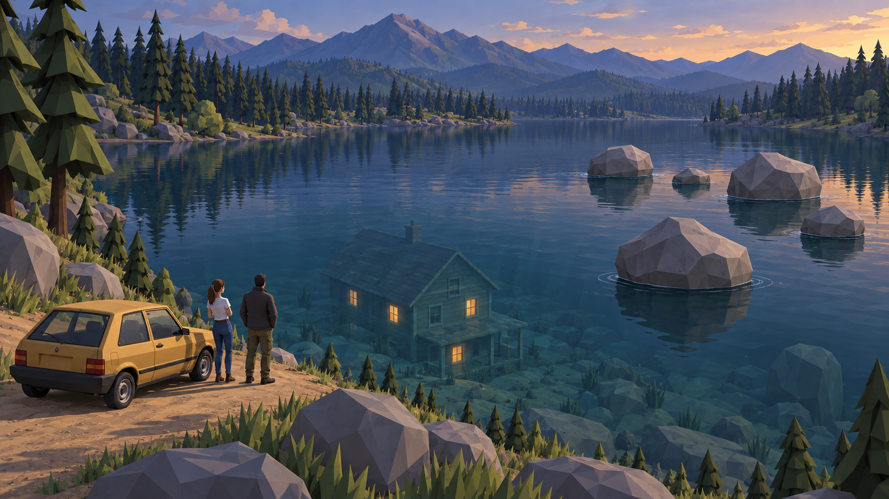
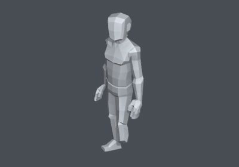
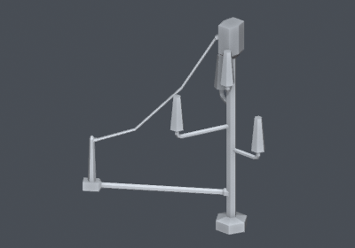
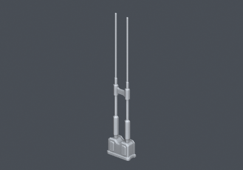

# 선택한 이상현상 다섯 장면

2026-10-12. 위성을 제거하고 사용자가 선택한 여덟 이상현상을 다섯 개의 독립된 목표 샷으로 나눴다. 이 세트가 현재 검토용 방향이다. 이전 위성·머리 유물·링 이미지와 원본 자연 샷은 탐색 기록으로 보존한다.

각 이미지에는 기존의 작은 노란 소형차와 자연 월드 스타일을 유지했다. 모두 built-in ImageGen 콘셉트다. Unity 씬 생성, 프리팹 설치, 게임 규칙이나 저장 변경은 하지 않았다.

## 1 떠 있는 집과 길을 건너는 그림자

집의 바닥과 공중의 빈 간격을 보여 주고, 다른 쪽 도로에 집과 형태가 다른 넓은 그림자를 둔다. 운전 중에도 발견하는 원경 이상현상이다. 정지 이미지이므로 그림자가 실제로 이동한다는 증거는 아니다.

## 2 한곳을 향해 기운 숲

숲의 양쪽 나무가 공터 중심을 향해 기울고 중심에는 작은 장비 상자가 있다. 외곽의 정상 나무와 비교해 기울어진 구역을 읽는다. 차를 입구에 두고 두 사람이 걸어 들어가는 장면이다.

## 3 숲속의 빈 방과 인형들

나무가 세 면의 직선 벽을 만들고, 풀 없는 사각 바닥 가운데에 빈 의자 하나가 있다. 주변 나무 사이에는 얼굴 없는 마네킹형 인형 여섯 개를 배치했다. 실제 신티 마네킹의 FBX 렌더를 형태 레퍼런스로 사용했다.

> **정정 (2026-10-12, D22):** 사용자가 말한 인형은 마네킹이 아니라 아이들이 갖고 노는 곰인형 같은 봉제 인형이다. 구현은 신티 Toy_Bear_01·Plushie 곰인형으로 했다. [숲 현장 문서](../../../world-forest-site.md)

## 4 철제 나무

나무들 사이에 키 큰 금속 기둥·가로대·안테나봉·늘어진 선을 둔다. 잎 없는 나무처럼 보이다 가까이서 금속임을 알아챈다. 실제 SciFi Worlds 안테나 두 종류의 FBX 렌더를 참조한 조합 제안이다. 위성 패널이나 위성 접시는 사용하지 않는다.

## 5 가라앉지 않는 바위와 수면 아래 불 켜진 집

바위 다섯 개가 수면에 닿은 채 서로 떨어져 있다. 집은 지붕·굴뚝까지 물속에 있고 창문에서 따뜻한 빛이 나온다. 반사된 육지의 집으로 보이지 않도록 물속 건물 전체와 수면 위치를 드러냈다.

## 신티 자산 대응

| 대상 | 확인한 자산 | 현재 상태와 필요한 처리 |
|---|---|---|
| 떠 있는 집·물속 집 | PolygonFarm/Prefabs/Buildings/SM_Bld_Farmhouse_01.prefab, SM_Bld_Farmhouse_02.prefab | Manyworld에 존재. 위치 변경과 수중 표현은 후속 작업. 생성된 집은 정확한 원본 프리팹 렌더가 아니다 |
| 기운 숲·방의 벽 | PolygonNature/Prefabs/Trees/SM_Tree_Pine_01.prefab 등 | Manyworld에 존재. 배치와 회전으로 구성 가능. 실제 적용 시 주행·접근로와 콜라이더 검증 필요 |
| 빈 의자 | PolygonTown/Prefabs/Props/SM_Prop_Chair_01.prefab 등 | Manyworld에 존재. 원본 의자 형태를 비교해 선택 |
| 숲의 인형 | PolygonApocalypse/Models/SM_Prop_Mannequin_Male_01.fbx | 보유 백업 원본에서 확인하고 직접 렌더. Manyworld의 해당 FBX·프리팹은 이번 조사에서 확인되지 않음 |
| 철제 나무 | PolygonSciFiWorlds/Models/SM_Prop_Powerline_Antenna_01.fbx, SM_Prop_Antenna_01.fbx | 다른 로컬 프로젝트 원본에서 확인하고 직접 렌더. Manyworld 미설치. 단일 철제 나무 프리팹이 아니라 안테나 부분 조합·확대 제안 |
| 수면 바위 | PolygonNature/Prefabs/Rocks/SM_Rock_Boulder_01.prefab 등 | Manyworld에 존재. 수면 접촉 위치와 부력처럼 보이는 표현은 후속 작업 |
| 길을 건너는 그림자 | 신티 모델을 가리는 렌더 또는 그림자 마스크 사용 제안 | 전용 움직이는 그림자 자산을 찾았다는 뜻은 아님. 이동과 투영은 별도 구현 |

## 실제 모델 레퍼런스

회색은 Blender의 형태 비교용 임시 재질이다. 원본 Unity 재질·텍스처·런타임을 검증한 화면은 아니다. 모델별 원본 경로와 mesh/bounds는 native-references/native-model-previews.json에 기록했다.

마네킹 원본은 D:\Codex\cube125-unity_asset_backups\20260830_172201_city_cute_transition\Assets\Synty\PolygonApocalypse\Models 아래, 안테나 원본은 D:\Codex\cube125-unity\Assets\Synty\PolygonSciFiWorlds\Models 아래에서 읽기만 했다. 원본 자산은 복사하거나 수정하지 않았다.

## 결과 확인

- 최종 파일 정확히 다섯 개를 프로젝트에 저장했고 존재·크기·해상도·원본과의 SHA-256 일치를 verification.json에 기록했다.
- 각 생성 출력에서 위성 없음, 선택한 여덟 이상현상 포함, 서로 다른 구도, 차·인물·자연 월드의 연속성을 확인했다.
- 저노이즈 면 처리와 사물의 큰 형태를 우선했다. 건물·인물·물 표현은 신티의 실제 재질과 최종 Unity 결과에 맞춰 조정해야 한다.
- 수면 바위의 실제 부력, 그림자의 이동, 수중 창의 발광·굴절, 숲의 콜라이더, 마네킹의 게임 동작, 성능은 이 이미지로 검증하지 않았다.

생성 프롬프트 전문은 imagegen-prompts.txt. 이어서 구현할 때 이 세트를 기준으로 첫 도로 구간이나 숲 공터 하나에서 실제 프리팹 비교부터 진행한다.

